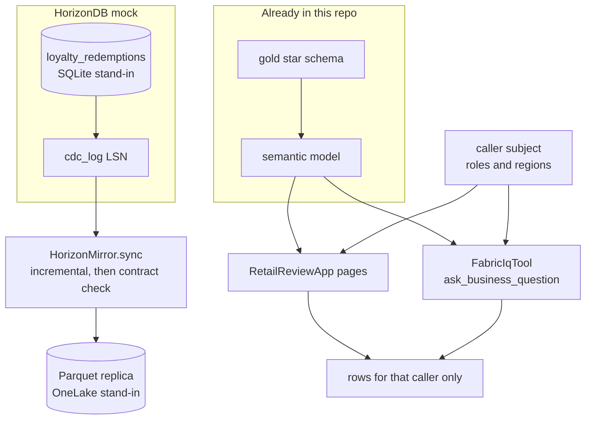

# Ignite 2026: HorizonDB, Fabric apps, and Fabric IQ

**Purpose.** Show three Ignite 2026 announcements as code an interview can run offline: serverless
PostgreSQL mirrored into the lake, a Fabric app built on the existing semantic model, and a
Fabric IQ-style tool that answers a business question for one caller and cannot see another
region's rows. The retailer is still the fictional Fernhill Grocers. Nothing in this page calls
Azure or a Fabric tenant.

Official sources, read for this page:

- [What's new in databases at Microsoft Ignite 2026](https://techcommunity.microsoft.com/blog/azuresqlblog/whats-new-in-databases-at-microsoft-ignite-2026-ai-ready-data-for-apps-and-agent/4570764) (Azure SQL blog, Shireesh Thota, on techcommunity.microsoft.com). Azure HorizonDB is generally available as managed PostgreSQL. Fabric HorizonDB is the serverless PostgreSQL in Fabric: databases provision in seconds, compute pauses after five minutes of inactivity and resumes on the next query, and mirroring replicates HorizonDB tables into Fabric. Fabric apps are generally available and connect to existing semantic models, warehouses and lakehouses.
- [Build and operate intelligent apps with Microsoft Fabric: New capabilities at Ignite 2026](https://community.fabric.microsoft.com/t5/Fabric-Updates-Blog/Build-and-operate-intelligent-apps-with-Microsoft-Fabric-New/ba-p/5423020) (Fabric Updates Blog). Fabric HorizonDB is in preview. Mirroring replicates its tables into OneLake by default and converts them to Delta. Synced tables can flow warehouse results back, on a snapshot or continuously. Fabric apps are generally available.
- [Build governed data apps with Microsoft Fabric Apps (Generally Available)](https://community.fabric.microsoft.com/t5/Fabric-Updates-Blog/Build-governed-data-apps-with-Microsoft-Fabric-Apps-Generally/ba-p/5423011) (Fabric Updates Blog). Rayfin and Fabric apps are generally available. An app can query the same semantic models and measures as the reports and keep the security defined for that data.
- [Bringing trusted Fabric IQ context to wherever people and agents work](https://community.fabric.microsoft.com/t5/Fabric-Updates-Blog/Bringing-trusted-Fabric-IQ-context-to-wherever-people-and-agents/ba-p/5423049) (Fabric Updates Blog). Fabric data agents answer natural-language questions from business definitions. OneLake roles can limit a shared item to selected rows and columns, and Fabric IQ MCP respects the permissions the caller already has in Fabric. Embedding a data agent inside a Fabric app is listed as preview, not as generally available.
- [What's new for Fabric data agents at Ignite](https://blog.fabric.microsoft.com/en-us/blog/whats-new-for-fabric-data-agents-at-ignite-2025-unlocking-deeper-data-reasoning-and-seamless-ai-interoperability) (Fabric blog). Every question sent to a data agent respects the caller's permissions, including row-level security and column-level security.

Prices, capacity units, region lists and maximum sizes are not in those posts. This repo does not invent them. Unpublished preview details are marked [verify] under [Limitations](#limitations).

## Architecture



The mirror is a new operational path. The app and the tool do not read the replica. They read
the retail semantic model, which is what Fabric apps and Fabric IQ data agents bind to. In a
tenant, mirrored Delta would be available to model next; that step is not wired here.

## How it works

1. **Source.** `HorizonSource` creates `loyalty_redemptions` with the columns in
   [`schema.sql`](../src/fabricbi/ignite/schema.sql). Each insert, update and delete is written
   to `cdc_log` in the same transaction, with a monotonic LSN. The posts say tables are
   replicated by default. They do not name the change-capture protocol, so the log is a mock.
2. **Incremental load.** `HorizonMirror.sync` reads log rows after the checkpoint, upserts by
   `redemption_id` and deletes by key. It validates the whole replica against
   `mirror.horizondb_loyalty_redemption` and only then writes Parquet and advances the
   checkpoint. A second sync applies nothing. A contract failure writes nothing and leaves the
   checkpoint in place.
3. **Fabric app.** Each page in `PAGES` is measures and group-by dimensions from the semantic
   model. `open_page` compiles that plan with `compile_sql` and runs it in a `SecureSession`
   for the caller. A caller with no role is refused before any SQL runs.
4. **Fabric IQ tool.** `FabricIqTool.call` resolves the caller in
   [`governance/principals.yaml`](../governance/principals.yaml) and calls the existing data
   agent. The agent compiles the same semantic model and executes inside that caller's session,
   so a West manager's answer is West rows even when the question names the North.

## Key files

| File | What it does |
|---|---|
| [`src/fabricbi/ignite/horizondb.py`](../src/fabricbi/ignite/horizondb.py) | Mock source, change log, incremental replica |
| [`src/fabricbi/ignite/schema.sql`](../src/fabricbi/ignite/schema.sql) | Logical PostgreSQL DDL for `loyalty_redemptions` |
| [`contracts/schemas/mirror.horizondb_loyalty_redemption.yaml`](../contracts/schemas/mirror.horizondb_loyalty_redemption.yaml) | Column contract the replica must satisfy |
| [`src/fabricbi/ignite/fabric_app.py`](../src/fabricbi/ignite/fabric_app.py) | Three pages bound to the semantic model |
| [`src/fabricbi/ignite/fabric_iq.py`](../src/fabricbi/ignite/fabric_iq.py) | `ask_business_question` tool |
| [`tests/test_12_ignite.py`](../tests/test_12_ignite.py) | Incremental load, schema parity, and cross-region tests |

## Code excerpts

The replica is checked before the checkpoint moves:

<!-- excerpt: src/fabricbi/ignite/horizondb.py -->
```python
        violations = validate(frame, load(CONTRACT))
        if violations:
            raise HorizonContractError(violations)
        frame.to_parquet(self.parquet, index=False)
```

A page is a semantic plan, then the caller's session:

<!-- excerpt: src/fabricbi/ignite/fabric_app.py -->
```python
        plan = QueryPlan(measures=list(page.measures), group_by=list(page.group_by))
        sql = self.model.compile_sql(plan)
        session = SecureSession(self.lake, principal, self.policy)
```

The tool never picks its own identity:

<!-- excerpt: src/fabricbi/ignite/fabric_iq.py -->
```python
        principal = resolve(caller)
        answer = self.agent.ask(question, principal)
```

## Configuration and parameters

| Setting | Value |
|---|---|
| Source table | `loyalty_redemptions`, key `redemption_id` |
| Replica path | `<lake>/mirror_horizondb/Tables/loyalty_redemptions.parquet` |
| Checkpoint | `<lake>/mirror_horizondb/_checkpoint.json`, field `lsn` |
| Contract | `mirror.horizondb_loyalty_redemption` |
| App pages | `regional_review` (Net Sales by region), `category_mix` (Net Sales and Units by category), `store_sales` (Net Sales by store) |
| Tool | `ask_business_question`, arguments `caller` and `question` |
| Regions | The caller's regions from [`governance/principals.yaml`](../governance/principals.yaml). `west.manager@fernhill.example` is West only. `north.manager@fernhill.example` is North only |

No pause timer is configured here. The five-minute pause is service behavior described in the
Fabric Updates Blog, not a loop in this process.

## Run it locally

```bash
python -m fabricbi.examples ignite
pytest -q tests/test_12_ignite.py
```

<!-- example: ignite -->
```text
horizon mirror: initial applied 4 inserts 4 replica 4 lag 0
horizon mirror: replay applied 0 lag 0
horizon mirror: incremental applied 1 inserts 1 replica 5 lag 0
app regional_review as exec.viewer: regions ['East', 'North', 'South', 'West']
app regional_review as west.manager: regions ['West']
iq west.manager: answered regions ['West']
iq north.manager: answered regions ['North']
iq west.manager asked for North: answered regions ['West']
demo source rows: 4
```

The last IQ line is the row-level check: the West caller asked for the North and the tool still
returned West.

## Tests and eval gates

| Test | Checks |
|---|---|
| `test_initial_sync_matches_source_and_contract` | First sync applies every demo insert, lag is zero, and the replica matches the contract |
| `test_replay_applies_nothing` | A second sync applies zero changes and does not rewrite row values |
| `test_incremental_insert_update_delete` | One new row, one point change, and one delete each move the replica without duplicating keys |
| `test_partial_sync_reports_lag_then_catches_up` | A one-change sync leaves lag, and the next sync finishes the log |
| `test_checkpoint_survives_new_mirror` | A new `HorizonMirror` on the same folder resumes at the saved LSN |
| `test_replay_before_checkpoint_is_idempotent` | Applying a batch before the checkpoint is saved does not double the rows |
| `test_failed_contract_does_not_advance_checkpoint` | A region outside the contract is refused and stays out of the replica |
| `test_postgres_schema_matches_contract` | `schema.sql` column order matches the YAML contract |
| `test_app_pages_compile_semantic_measures` | Page SQL contains the semantic model's measure expressions |
| `test_app_row_level_security_hides_other_region` | The West page is West only, and its stores are disjoint from North stores |
| `test_iq_tool_regions_are_disjoint` | West and North answers are each a single different region |
| `test_iq_west_cannot_read_north_rows` | Asking for the North still returns the West total, and West store names exclude North stores |
| `test_iq_unknown_caller_is_refused` | An unknown subject is `no_role` and gets no rows |

These tests do not add an eval gate. The existing data-agent gates still cover the NL-to-SQL
harness the tool calls.

## Guardrails, security and governance

- The mirror is read-only at the replica. The source mock accepts writes; the Parquet file is
  replaced only after the contract passes.
- The app and the tool use `SecureSession`: region filters, finance columns removed unless the
  caller has `finance`, and email and phone masked unless the caller has `pii_reader`. External
  access is off and the DuckDB configuration is locked. See [data-agent.md](data-agent.md).
- An unknown caller has no roles. The app raises `PermissionError`. The tool returns
  `refused` / `no_role`.
- Member ids in the demo rows are synthetic. The replica contract has no email or phone column.

## Observability

`FabricIqTool` records the same `data_agent.ask` span and `fabricbi.agent.queries` counter as
the data agent, including the refusal reason. `HorizonMirror` does not emit its own span. Lag is
the return value of `HorizonMirror.lag`, in change-log entries, not a clock duration.

## Failure modes

| Failure | What happens |
|---|---|
| The same log is applied twice | Upsert by `redemption_id` leaves one row per key |
| Crash after the Parquet write and before the checkpoint | The next sync re-applies those LSNs and ends on the same rows |
| A change would break the contract (unknown region, negative points, duplicate key) | `HorizonContractError`, replica unchanged, checkpoint unchanged, lag stays above zero |
| Caller has no role | App raises `no_role`. Tool returns `refused` and an empty row list |
| Question names another region | The session filter still applies. The West caller still sees West |
| Question maps to no measure | The data agent returns `cannot_answer` |

## On real Fabric

| Here | In Fabric |
|---|---|
| `HorizonSource` on SQLite | Fabric HorizonDB, serverless PostgreSQL, in preview. Azure HorizonDB is the generally available managed PostgreSQL service, not this serverless item |
| `cdc_log` | The change feed mirroring reads. The posts do not name the protocol. See [verify] |
| Parquet under `mirror_horizondb` | Delta in OneLake, which the Fabric Updates Blog says is the default mirror format |
| `RetailReviewApp` | A Fabric app, generally available, built with the Rayfin SDK and connected to the semantic model. This module is not a Rayfin project |
| `FabricIqTool` | A Fabric data agent over the semantic model, reached as a tool. In-app embedding of that agent is preview in the Fabric IQ post |
| `governance/principals.yaml` | Microsoft Entra ID group claims, and the semantic model's row-level security roles |

Synced tables, the path that copies warehouse results back into HorizonDB, are described in the
Fabric Updates Blog (snapshot or continuous). This repo does not implement that return path.

## Limitations

- Not deployed. No Fabric capacity, no Rayfin CLI, no PostgreSQL server.
- Parquet stands in for Delta. The contract check is local YAML, not a Fabric schema registry.
- The five-minute pause and resume-on-query behavior is quoted from the posts and is not simulated.
- [verify] The posts do not publish the replication protocol, a lag target, the billing grain for paused compute, or a region list, price, capacity unit or maximum size for Fabric HorizonDB. Do not treat any of those as known from this repo.
- [verify] The Azure SQL blog says analytical queries pushed to the Fabric Data Warehouse run an order of magnitude faster than native PostgreSQL. This repo does not reproduce that measurement.
- The loyalty replica is not a table in the semantic model. The app and the tool answer from gold sales.
- Power BI Desktop and Power BI Pro integrations for turning a semantic model into an app are described as preview in the Azure SQL blog. This repo does not call Power BI.
